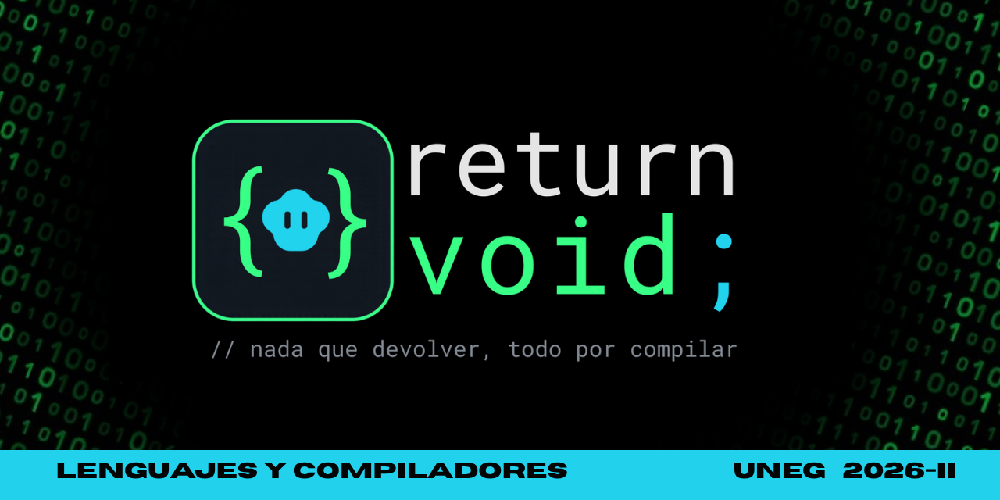

<p align="center">  </p> <h2 align="center">¡Les damos la bienvenida al repositorio del grupo return void;!</h2>
Aquí vamos a ir subiendo las tareas y actividades de la materia Lenguajes y Compiladores, dirigida por el Ing. Félix Márquez de la UNEG. Somos estudiantes del séptimo semestre de Ingeniería en Informática.


## **Información del curso**

| Campo | Detalle |
|---|---|
| **Universidad** | Universidad Nacional Experimental de Guayana (UNEG) |
| **Vicerrectorado** | Académico |
| **Coordinación** | Ingeniería en Informática |
| **Asignatura** | Lenguajes y Compiladores |
| **Profesor** | Ing. Félix Márquez |s
| **Periodo** | 2026-II |

## **Integrantes**

| Nombre | C.I. | Sección | Rol |
|---|---|---|---|
| **Ines Salazar** | 31.701.669 | 1 | Líder |
| **Licett Avendaño** | 18.886.013 | 1 | Integrante |
| **Lismarx Gamboa** | 30.994.146 | 1 | Integrante |
| **Fabiola Olaya** | 31.869.294 | 3 | Integrante |

## **Estructura del repositorio**

Cada producto del curso tiene su propia carpeta, con el proyecto (códigos), los informes y el enlace al drive donde está el video de la defensa.

```
return-void/
├── README.md
├── banner.png
├── PRUEBA_DIAGNOSTICA/
│   ├── Licett_Avendaño/
│   ├── Ines_Salazar/
│   ├── Lismarx_Gamboa/
│   └── Fabiola_Olaya/
├── TEMA1/
├── TEMA2/
├── TEMA3/
└── TEMA4/
```

Cada carpeta de producto incluye:

- **Código:** el proyecto desarrollado.
- **Informes:** documentos en normas APA, con citas y referencias.
- **Video de la defensa:** enlace a un drive.

## **Normas de trabajo del grupo**

- Todos los integrantes son colaboradores del repositorio, así que cada aporte queda registrado en los commits y pushes.
- El líder es responsable de formalizar las entregas por correo.
- El grupo responde por el código entregado, incluso el generado con IA, y cada integrante debe poder defenderlo.
- Los integrantes del grupo no cambian durante el curso.

## **Avance de productos**

| Producto | Estado |
|---|---|
| **Prueba diagnóstica** | Entregados |
| **Tema 1** | Pendiente |
| **Tema 2** | Pendiente |
| **Tema 3** | Pendiente |
| **Tema 4** | Pendiente |

<p align="center">
  <b>LENGUAJES Y COMPILADORES · UNEG 2026-II</b>
</p>