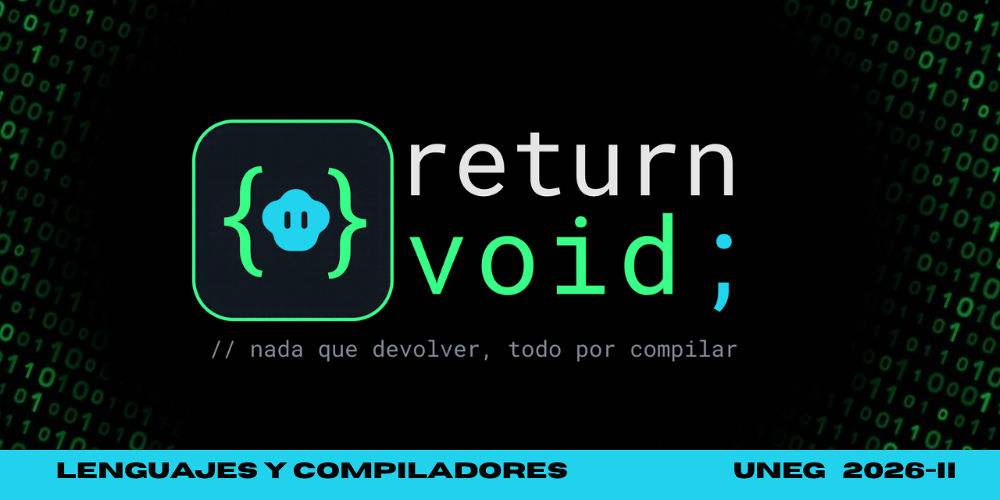

  

<h2 align="center">Tema 1 · Planteamiento 10: AFD y AFN</h2>

Equipo, esto es lo que hay que hacer para el Tema 1 de Lenguajes y Compiladores. Nos tocó el planteamiento 10: **Autómatas finitos determinísticos (AFD) y no determinísticos (AFN)**. Lean todo antes de empezar y pongan su nombre en la parte que van a llevar.

## Qué pide el profe

Se evalúa sobre 15 puntos. Una parte es del grupo y otra es de cada uno.

| Parte | Puntos | Qué es |
|---|---|---|
| Defensa | 10 | Un video donde cada quien explica un punto de lo investigado. Es individual, así que cada uno tiene que entender lo suyo de verdad. |
| Informe y entregables | 5 | Informe grupal en APA, reto evaluado, código, presentación y repositorio ordenado. |

> **Fecha:** el PDF del profe dice "miércoles 24/11/2026", pero el 24 de noviembre de este año cae martes. Voy a escribirle para confirmar si es el martes 24 o el miércoles 25. Mientras tanto, trabajemos para tener todo listo el lunes 23.

## Lo que tenemos que entregar

- [ ] Informe de investigación del planteamiento 10, en APA estricto (citas y referencias obligatorias).
- [ ] Una sección dentro del informe con la solución de un solo reto evaluado: qué era el reto y cómo lo resolvimos.
- [ ] Video de defensa: un solo archivo con la intervención de todos, subido a Drive, con buena imagen y audio claro.
- [ ] Códigos fuente y scripts de configuración, si los hay.
- [ ] Presentación o material de apoyo.
- [ ] Repositorio (GitHub o GitLab) con una carpeta llamada `TEMA 1` con las versiones finales. El link del video va también en el repo.
- [ ] Correo de entrega enviado por la líder.

## Reparto de partes

Ajusto si somos más o menos de 5. Cada parte va al informe y también al video.

### Parte 1: base teórica y por qué importa en un compilador

Responsable: Fabiola

- Qué es un lenguaje regular y dónde cae en la jerarquía de Chomsky (tipo 3).
- Qué es el análisis léxico y por qué se apoya en autómatas finitos.
- Expresiones regulares y su relación con los autómatas.

Video: 1 a 2 minutos explicando el contexto, como introducción de todo.

### Parte 2: AFD

Responsable: Patria

- Definición formal (la 5-tupla: estados, alfabeto, función de transición, estado inicial, estados finales).
- Cómo funciona paso a paso con una cadena.
- Mínimo 2 ejemplos con su diagrama de estados y tabla de transiciones (por ejemplo, identificadores y números enteros).

### Parte 3: AFN

Responsable: Lismarx

- Definición formal y qué cambia respecto al AFD (varias transiciones posibles, transiciones épsilon).
- Cómo se acepta una cadena en un AFN.
- Mínimo 2 ejemplos con diagrama, y el mismo lenguaje resuelto con AFD para poder comparar.

### Parte 4: comparativa y conversión

Responsable: Ines

- Tabla comparativa AFD vs AFN (poder de reconocimiento, tamaño, velocidad, facilidad de construcción).
- Conversión de AFN a AFD por construcción de subconjuntos, con un ejemplo resuelto a mano.
- Minimización de AFD.
- Cómo lo usan herramientas reales (Flex, ANTLR, RE2) para convertir expresiones regulares en autómatas.

### Parte 5: reto evaluado, código y repositorio

Responsable: Todos

- Desarrollar el reto que escojamos entre todos y escribir la sección del informe que lo explica.
- Subir el código a la carpeta `TEMA 1` con un README corto de cómo correrlo.

El reto no entra en el video, pero igual todos tienen que saber explicar qué hicimos.

### Mi parte como líder

- Mantener el repo ordenado y armar el informe final (portada, índice, referencias APA).
- Unir los videos en un solo archivo, subirlo a Drive y poner el link en el repo.
- Enviar el correo de entrega.

## Reto evaluado

Solo hace falta resolver uno, y lo escogemos entre todos.

El profe pide que el grupo se plantee un reto que todos resolvamos (puede ser uno interesante o uno altruista que atienda un problema de la humanidad). Cada quien piensa su propuesta y la manda al grupo antes del viernes 20: qué sería el reto y cómo lo resolvería. Con todas las propuestas sobre la mesa elegimos una entre todos.

## Reglas para el informe

- Cada quien escribe su parte con sus palabras. Se nota cuando es copiar y pegar, y además después tienen que defenderla en video sin leer.
- Todo dato que no sea suyo lleva cita APA en el texto y su referencia al final. Usen libros y artículos, no solo páginas sueltas. El libro de Aho, Lam, Sethi y Ullman (2006) que cita el profe es buen punto de partida.
- Los diagramas de estados los hacemos nosotros (JFLAP, draw.io o Graphviz). No copiar imágenes de internet.
- Cada parte en un archivo aparte hasta el día de armar, para que no se pisen los cambios.

## Fechas internas

| Día | Qué |
|---|---|
| Jueves 19 | Cada quien confirma su parte. |
| Viernes 20 al domingo 22 | Investigar y escribir cada parte. El reto se programa en estos días. |
| Domingo 22, noche | Partes escritas listas. Las reviso y las junto. |
| Lunes 23 | Grabar los videos (cada quien el suyo) y revisión final del informe. |
| Martes 24 | Subir todo, enviar el correo. Si la fecha real es el 25, tenemos un día de margen. |
